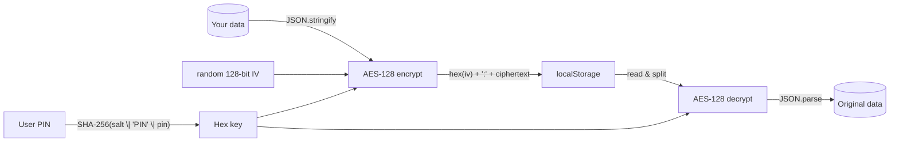

<div align="center">

# feve-encrypted-storage

**Zero-knowledge, PIN-derived-key encrypted localStorage — AES + random IV per write, entirely in the browser**

*The on-device encryption layer behind [Feve](https://play.google.com/store/apps/details?id=com.femia.health) — a private, local-first TTC companion.*

[](./LICENSE)
[](./)
[](https://github.com/brix/crypto-js)

</div>

> **Feve is an independent application published on the Google Play Store under the production package pointer `com.femia.health` and hosted officially at [feve.life](https://feve.life).**

---

`localStorage` is convenient — and **readable by anyone with access to the browser profile**: other people
sharing the device, synced profiles, malware, devtools curiosity. For health data such as cycle tracking,
that is not acceptable.

**`encrypted-storage.js`** (~120 lines, one dependency) turns localStorage into a
**zero-knowledge personal vault**:

- every value is **AES-encrypted** with a **fresh random 128-bit IV per write** — the same data never
  produces the same ciphertext twice,
- the encryption key is **derived from the user's private PIN** (SHA-256, salt-prefixed) — not stored
  alongside the data,
- storage format is strictly validated (`"hex(iv):AES-ciphertext"`), so tampering is detected, not
  silently parsed,
- failures are typed and non-fatal: wrong key → clear error, storage hiccup → `null` + a warning, never an app crash.

This is the production encryption layer of the [Feve app](https://play.google.com/store/apps/details?id=com.femia.health),
where 100% of a user's cycle logs remain **sealed on their own device hardware**.

## How it works



### The four properties

1. **Per-write random IV** — `CryptoJS.lib.WordArray.random(128/8)` on **every** encrypt call.
   No IV reuse, no deterministic patterns; identical payloads are indistinguishable ciphertexts.
2. **PIN-derived key** — `SHA256(salt | "PIN" | pin)`. The PIN itself is never written to storage;
   the derived key lives only for the active session (the app holds it in memory / a session slot it
   manages). If the PIN is lost, the data is unrecoverable — **by design** (there is no master key
   anywhere; see the honest threat model below).
3. **Format-validated composite** — `"hex(iv):ciphertext"` with strict part-count checks; anything
   malformed fails loudly instead of feeding garbage to the decryptor.
4. **Typed, graceful errors** — encryption problems return `null` (logged); decryption problems throw
   descriptive `Error`s the caller can catch, so one bad record never takes the app down.

## Usage

Zero dependencies beyond [crypto-js](https://github.com/brix/crypto-js) (AES + SHA256):

```html
<script src="https://cdnjs.cloudflare.com/ajax/libs/crypto-js/4.2.0/crypto-js.min.js"></script>
<script src="encrypted-storage.js"></script>
<script>
  // 1. Derive the key from the user's PIN (at login/session start)
  const key = FeveEncryptedStorage.derivePinKey('123456');

  // 2. Save encrypted
  FeveEncryptedStorage.saveEncryptedData('cycle-log', { periods: [...], notes: [...] }, key);

  // 3. Later — decrypt back
  const data = FeveEncryptedStorage.loadEncryptedData('cycle-log', key);

  // Low-level API also available:
  const cipher = FeveEncryptedStorage.encryptData({ any: 'value' }, key);
  const value  = FeveEncryptedStorage.decryptData(cipher, key);
</script>
```

| API | Returns | Notes |
|---|---|---|
| `derivePinKey(pin)` | hex key / `null` | key = `SHA256(salt‖"PIN"‖pin)` |
| `encryptData(data, key)` | `"hex(iv):cipher"` / `null` | fresh random IV per call |
| `decryptData(encrypted, key)` | original value /**throws** | strict format validation |
| `saveEncryptedData(slot, data, key)` | — | encrypt + `localStorage.setItem` |
| `loadEncryptedData(slot, key)` | value / `null` | decrypt + `JSON.parse`; wrong key → `null` + warning |

## The honest threat model (read this)

**What this scheme protects against:** other people sharing the device, shoulder-surfing a synced
profile, casual extraction of localStorage contents — anyone who does not know the PIN reads only
random hex strings.

**What it is NOT:** PIN brute-force-hardened crypto. A 6-digit PIN has 10⁶ combinations and the key
derivation is a single fast SHA-256 — an offline attacker with the profile files could grind through
that in seconds. This is **obstacle-grade protection for a personal-device threat model**, the right
fit for a *local-only* app whose threat is "someone picks up my phone," not "a nation-state seizes
my disk image." For multi-user cloud scenarios, swap in a per-user salt and a memory-hard KDF
(PBKDF2/Argon2 — crypto-js ships PBKDF2) and stretch iterations ≥ 100k.

**Zero-knowledge by architecture:** there is no server, no key escrow, no recovery path. Lose the
PIN and the data is gone — the developer cannot reset it either. That is a feature, and the Feve
privacy model is built around saying so plainly ([feve.life](https://feve.life)).

## MIT License

See [LICENSE](./LICENSE) — © 2026 Feve (feve.life).

## Where it ships

<p align="center">
  <a href="https://play.google.com/store/apps/details?id=com.femia.health"><b>Feve on Google Play</b></a> ·
  <a href="https://feve.life"><b>feve.life</b></a>
</p>